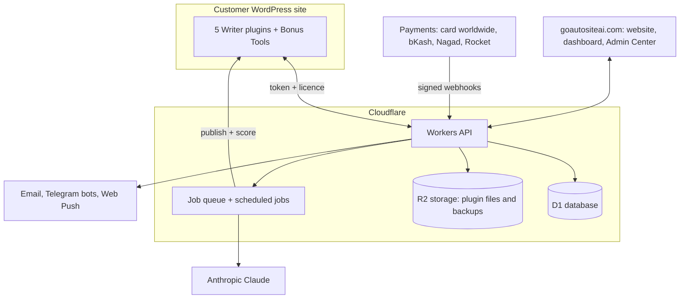

# GoAutoSiteAI: Case Study

**An AI platform that runs a WordPress website on autopilot.**
It researches, writes, publishes, optimises and promotes SEO articles in 29 languages, while the owner runs customers, payments and support from one Admin Center.

[Live product](https://goautositeai.com) · [Full case study with screenshots](https://nahidreza.com/work/goautositeai) · [Build story](https://nahidreza.com/blog/how-i-built-goautositeai)

> This repository documents **how the system was designed and built**. The product's source code is private (it is a paid product), so this page shows the architecture, decisions and verified results instead. Screenshots have customer data blurred.

## The problem

Owners of blogs, coupon sites, affiliate sites and AdSense sites repeat the same work every week: research a topic, write, format, add images, fix SEO, publish, share, and later refresh old posts. Generic AI writers make it worse with thin content that can hurt rankings.

## The solution

Five specialised AI **Writers** (WordPress plugins) and one **Bonus Tools** plugin with 13 helpers, connected to a central cloud service. The customer installs a plugin, connects with one token, picks how to work, and articles appear on their site: formatted, SEO-optimised, with images, in the reader's language, on a schedule.

| Writer | What it makes |
|---|---|
| Blog Writer | Guides, how-tos, listicles, news rewrites, refreshes |
| Coupon Writer | Coupon and deal pages that stay fresh every 30 days |
| Affiliate Writer | Reviews, comparisons and best-of lists with disclosures |
| AdSense Writer | Long informational articles for display-ad sites |
| Health Writer | Careful health content with safety-minded rules |

## Architecture

## What was built

<table>
<tr><td width="50%"> <b>Customer dashboard</b>: plan, credits, get started in 3 steps, licensed downloads, 9 languages</td>
<td width="50%"> <b>Writer plugin</b>: five simple ways to work, main action on the first screen</td></tr>
<tr><td> <b>Admin Center</b>: customers, payments, refunds, revenue, cost per article</td>
<td> <b>Team live chat</b>: AI first, then a real person, with handoff and voice typing</td></tr>
<tr><td> <b>Pricing and billing</b>: USD card worldwide or Taka in Bangladesh, one-click checkout</td>
<td> <b>Release Center</b>: test site first, then everyone, with rollback</td></tr>
</table>

## Hard problems solved

1. **Payments that verify themselves.** Plans switch on only after a signed confirmation, with amount and product checks. A key-format flaw that would have blocked every automatic activation was found in the final pre-launch check and fixed before any customer paid.
2. **"N/A" SEO scores.** Rank Math only scores posts opened in the editor. A background scorer runs Rank Math's own analyzer so every generated article shows its real score.
3. **The right language everywhere.** FAQ headings, buttons, disclosures and the HTML language tag follow each article's language across 29 languages, including right-to-left scripts.
4. **Autopilot without visitors.** Schedules run in the cloud, so articles publish on time even if nobody opens the site.
5. **A self-healing job queue.** Stuck jobs are retried; after the final failure the credits are refunded and the customer is told.
6. **One-click releases with undo.** New plugin versions go to a test site first, then to everyone; customer sites update themselves and report errors back.
7. **Simple for non-technical customers.** Every screen was redesigned so the main action is visible first, scheduling became "How many per day? 1 / 2 / 3", and jargon was replaced with plain words.

## Verified results

| Measure | Result |
|---|---|
| WordPress plugins shipped | 6 (5 Writers + Bonus Tools) |
| Languages for articles | 29 |
| Customer dashboard languages | 9 |
| Load test | 900 visits, 50 at the same time, **0 failures** |
| Home page server response | about **0.16 s** |
| Rank Math score on generated articles, before editing | **70–86 / 100** (test site) |
| AI cost per English article | about **$0.08** |

## Tech stack

WordPress plugins (PHP, JavaScript) · Cloudflare Workers, D1, R2, Queues, Cron · Anthropic Claude · Resend · Telegram Bot API · Web Push · Rank Math · IndexNow · Playwright for automated browser tests

## How it was built

Built over about two months (September to October 2026) by **Nahid Reza** as product owner and developer, using AI pair-programming. Public launch: December 2026.

---

Need a system like this for your business? [Book a free 30-minute call](https://nahidreza.com/book) · [nahidreza.com](https://nahidreza.com)
